# Task Board

_Generated by `scripts/generate_tasks.py` from `backlog/*.yaml` — do not edit by hand._

**65 tasks** · content: 7 · design: 9 · dev: 26 · devops: 4 · human: 6 · test: 13

## Critical path
P0-01 → P0-02 → F-02 → F-03 → F-06 → F-08 → F-16 → F-18 → F-19 → F-20 → F-21 → F-22 → T-07b

## How to read this
- A task may start when every task in *Depends on* is `done`.
- Tasks in the same wave run in parallel as soon as their own dependencies are done (some depend on a task earlier in the same wave). The generator guarantees that tasks in the same wave never own the same files.
- Model per task: `haiku` = mechanical and fully specified · `sonnet` = normal implementation · `opus` = infrastructure, architecture-heavy or tricky · `fable` = highest stakes (anti-hallucination core, fact verification, design direction, final test audit) · `human` = Shuki. See docs/06_ORCHESTRATION.md §1.

## Wave 0 — Foundation

| ID | Title | Agent | Model | Size | Depends on | Status |
|---|---|---|---|---|---|---|
| [H-01](tasks/H-01.md) | Answer open decisions; create Base44 app, deploy key and GitHub repo | human | human | S | — | todo |
| [O-01](tasks/O-01.md) | Spike — verify Base44 deploy-dist end to end and document it | devops | opus | M | P0-01, H-01 | todo |
| [P0-01](tasks/P0-01.md) | Scaffold the repository with every dependency and npm script | dev | opus | M | — | done |
| [P0-02](tasks/P0-02.md) | Copy the frozen contracts into src and implement t() | dev | sonnet | S | P0-01 | done |
| [P0-03](tasks/P0-03.md) | Test infrastructure — Vitest, Playwright projects and shared helpers | test | opus | M | P0-01 | done |

**Gate G1 — Foundation** (Shuki): decisions answered, Base44 app + key, deploy spike works.

## Wave 1 — Parallel lanes start

| ID | Title | Agent | Model | Size | Depends on | Status |
|---|---|---|---|---|---|---|
| [C-02](tasks/C-02.md) | Verify every quote and key fact against the original articles | content | fable | L | — | done |
| [C-03](tasks/C-03.md) | Candidate coordinates for every station (for Shuki to verify) | content | sonnet | M | — | done |
| [D-01](tasks/D-01.md) | Design principles and tone | design | opus | S | — | done |
| [D-02](tasks/D-02.md) | Design tokens with a contrast table | design | sonnet | M | D-01 | done |
| [D-03](tasks/D-03.md) | Component specifications for every component | design | opus | L | D-02 | done |
| [D-05](tasks/D-05.md) | Route schematic map as an offline SVG | design | sonnet | M | D-02 | done |
| [D-06](tasks/D-06.md) | Icon list (Lucide) with RTL rules | design | haiku | S | D-01 | done |
| [F-01](tasks/F-01.md) | Geo and link utilities with 100% test coverage | dev | sonnet | M | P0-02 | done |
| [F-02](tasks/F-02.md) | Content converter — Markdown sources to validated JSON (anti-hallucination core) | dev | fable | L | P0-02 | done |
| [F-04](tasks/F-04.md) | Format and storage utilities with 100% test coverage | dev | sonnet | M | P0-02 | done |
| [H-03](tasks/H-03.md) | Inform the families and record their consent (runs in parallel; blocks public launch) | human | human | L | — | todo |
| [O-02](tasks/O-02.md) | Continuous integration — checks, bundle budgets, end-to-end on every pull request | devops | sonnet | M | P0-01, P0-03 | done |

## Wave 2 — Building blocks

| ID | Title | Agent | Model | Size | Depends on | Status |
|---|---|---|---|---|---|---|
| [C-01](tasks/C-01.md) | Proofread the generated JSON against the Markdown sources | content | sonnet | M | F-02 | done |
| [C-05](tasks/C-05.md) | Second verification pass on open items using the official "Le'ad" memorial site | content | fable | M | C-02 | done |
| [D-04](tasks/D-04.md) | Responsive page mockups with real content (gate G2) | design | opus | L | D-03, D-05, D-06 | done |
| [D-07](tasks/D-07.md) | Microcopy review of all UI strings (values only) | design | opus | M | D-01, P0-02 | done |
| [D-08](tasks/D-08.md) | Brand mark, app icons and social image | design | sonnet | M | D-02 | done |
| [F-03](tasks/F-03.md) | Content loader, cross-reference validation and fictional E2E fixtures | dev | opus | M | F-02, F-01 | done |
| [F-05](tasks/F-05.md) | Wire design tokens and self-hosted fonts into Tailwind | dev | haiku | S | D-02, P0-01 | done |
| [F-06](tasks/F-06.md) | App shell — hash routing, responsive layout, skip link, 404 and page stubs | dev | opus | L | F-05, F-04, F-03, D-03, D-06, P0-02 | done |
| [F-07](tasks/F-07.md) | Primitive components — Button, headings, Markdown, quote, photo frame, sources, share | dev | sonnet | M | F-05, D-03, D-06, F-04 | done |
| [H-02](tasks/H-02.md) | Verify station coordinates and set them in the content source | human | human | M | C-03, F-02 | todo |
| [T-01](tasks/T-01.md) | Content integrity — no drift, independent fidelity check, sources (CI-03, CI-04, CI-05) | test | opus | M | F-02, P0-03 | done |

**Gate G2 — Look & feel** (Shuki): approve the mockups from D-04 before wave-4 pages are built.

## Wave 3 — Components

| ID | Title | Agent | Model | Size | Depends on | Status |
|---|---|---|---|---|---|---|
| [C-06](tasks/C-06.md) | Apply the content corrections Shuki approved from C-02 and C-05 | content | opus | M | C-05, F-02, T-01 | done |
| [F-07b](tasks/F-07b.md) | Small, quiet photo placeholder (gate G2 decision) | dev | haiku | S | F-07, D-04 | done |
| [F-08](tasks/F-08.md) | Reading depth tabs and the read-aloud toggle | dev | sonnet | M | F-06, F-07, F-04 | done |
| [F-09](tasks/F-09.md) | Content-warning gate and moment-of-silence components | dev | sonnet | M | F-07, F-04, D-07 | done |
| [F-10](tasks/F-10.md) | Tour components — station card, person card, stepper, navigation links, driver banner | dev | sonnet | M | F-01, F-03, F-04, F-07, D-03 | done |
| [F-11](tasks/F-11.md) | RouteMap component from the designed SVG | dev | sonnet | M | D-05, F-03, F-07 | done |
| [F-12](tasks/F-12.md) | 'Where am I' — on-device geolocation hook and nearby banner | dev | sonnet | M | F-01, F-03, F-07, F-04 | done |
| [T-02](tasks/T-02.md) | Repository scans — photos, UI words, coordinates, string keys, RTL classes (CI-06..CI-10) | test | sonnet | M | F-06, F-07, D-07, P0-03 | done |

## Wave 4 — Pages

| ID | Title | Agent | Model | Size | Depends on | Status |
|---|---|---|---|---|---|---|
| [F-11b](tasks/F-11b.md) | Restore the three route-map labels with new UI string keys | dev | haiku | S | F-11 | done |
| [F-13](tasks/F-13.md) | Home page | dev | sonnet | M | F-06, F-07, F-10, F-08, D-04 | done |
| [F-14](tasks/F-14.md) | Tour overview page | dev | sonnet | M | F-10, F-11, F-12, F-06, D-04 | done |
| [F-15](tasks/F-15.md) | Station page | dev | opus | L | F-07, F-09, F-10, F-06, F-04, D-04 | done |
| [F-16](tasks/F-16.md) | Person page with reading depth and content-warning gate | dev | opus | L | F-07, F-08, F-09, F-06, D-04 | done |
| [F-17](tasks/F-17.md) | About and Sources pages | dev | sonnet | M | F-07, F-03, F-06, D-04 | done |

## Wave 5 — PWA, deploy & end-to-end tests

| ID | Title | Agent | Model | Size | Depends on | Status |
|---|---|---|---|---|---|---|
| [F-18](tasks/F-18.md) | Offline PWA — manifest, service worker, offline indicator, update prompt | dev | opus | L | F-13, F-14, F-15, F-16, F-17, D-08 | done |
| [F-19](tasks/F-19.md) | Performance pass against the budgets | dev | opus | M | F-18 | done |
| [O-03](tasks/O-03.md) | Deploy pipeline to Base44 with post-deploy smoke tests | devops | opus | M | O-01, O-02, F-18, T-10 | todo |
| [T-03](tasks/T-03.md) | End-to-end — navigation, deep links, progress (E2E-NAV-01..03) | test | sonnet | M | F-13, F-14, F-15, F-16, F-17, P0-03 | done |
| [T-04](tasks/T-04.md) | End-to-end — geolocation and navigation links on fixture content (E2E-GEO-01..05, E2E-LINK-01) | test | sonnet | M | F-12, F-14, F-15, F-03, P0-03 | done |
| [T-05](tasks/T-05.md) | End-to-end — offline and installable PWA (E2E-OFF-01..02, E2E-PWA-01) | test | opus | M | F-18, T-03, P0-03 | done |
| [T-06](tasks/T-06.md) | End-to-end — safety rules, reading modes, share (E2E-SAFE-01..05, E2E-READ-01, E2E-SHARE-01) | test | sonnet | M | F-13, F-14, F-15, F-16, F-17, P0-03 | done |
| [T-07](tasks/T-07.md) | End-to-end — responsive layout and visual baselines (E2E-LAYOUT-01..04) | test | sonnet | M | F-13, F-14, F-15, F-16, F-17, P0-03 | done |
| [T-08](tasks/T-08.md) | Accessibility — axe on every route and keyboard walk (E2E-A11Y-01..02) | test | sonnet | S | F-13, F-14, F-15, F-16, F-17, P0-03 | done |
| [T-09](tasks/T-09.md) | Lighthouse CI — performance, accessibility, best practices (LH-01) | test | haiku | S | F-18, F-19, O-02 | done |
| [T-10](tasks/T-10.md) | Post-deploy smoke tests against the live URL (E2E-SMOKE-01..03) | test | haiku | S | F-18, P0-03 | done |

## Wave 6 — QA & launch

| ID | Title | Agent | Model | Size | Depends on | Status |
|---|---|---|---|---|---|---|
| [C-04](tasks/C-04.md) | Proofread every page on the deployed site at phone size | content | sonnet | M | O-03 | todo |
| [C-07](tasks/C-07.md) | Draft gentle openings for the five graphic people (for Shuki's approval) | content | opus | S | D-09 | done |
| [D-09](tasks/D-09.md) | Design QA of the built app and approval of visual baselines | design | opus | M | T-07, F-13, F-14, F-15, F-16, F-17, F-18 | done |
| [F-20](tasks/F-20.md) | Remove layout shift — offline-ready message and font swap (from F-19 review) | dev | sonnet | S | F-19, F-18 | done |
| [F-21](tasks/F-21.md) | Design QA fixes (D-09 findings 1, 2, 5–8, 10–13) | dev | sonnet | M | D-09, F-20 | done |
| [F-22](tasks/F-22.md) | Gentle opening for graphic people — schema, converter and pages (Shuki's G2 follow-up) | dev | opus | M | F-21 | done |
| [H-05](tasks/H-05.md) | Field test the whole route with the deployed app on two phones | human | human | M | O-03 | todo |
| [H-06](tasks/H-06.md) | Final content and sensitivity sign-off | human | human | S | C-01, C-02, C-04, H-02, H-05, D-09, C-05, C-06 | todo |
| [L-01](tasks/L-01.md) | Soft launch — final checklist, go/no-go, first users | devops | opus | S | H-06, T-11, D-09, T-09, H-03, O-03, H-05 | todo |
| [T-07b](tasks/T-07b.md) | Regenerate and harden the visual baselines (D-09 finding | test | sonnet | S | F-21, F-22, T-07 | done |
| [T-11](tasks/T-11.md) | Test audit — coverage, gaps, flakiness | test | opus | M | T-01, T-02, T-03, T-04, T-05, T-06, T-07, T-08, T-09, T-10, F-19 | review |

**Gate G3 — Launch** (Shuki): field test H-05 passed and sign-off H-06 before L-01.

## Wave 7 — Post-launch

| ID | Title | Agent | Model | Size | Depends on | Status |
|---|---|---|---|---|---|---|
| [H-04](tasks/H-04.md) | Add family-approved photos (after launch is fine) | human | human | M | H-03, F-02 | todo |

## Dependency graph

```mermaid
flowchart LR
  subgraph W0["Wave 0 · Foundation"]
    H_01["H-01"]
    O_01["O-01"]
    P0_01["P0-01"]
    P0_02["P0-02"]
    P0_03["P0-03"]
  end
  subgraph W1["Wave 1 · Parallel lanes start"]
    C_02["C-02"]
    C_03["C-03"]
    D_01["D-01"]
    D_02["D-02"]
    D_03["D-03"]
    D_05["D-05"]
    D_06["D-06"]
    F_01["F-01"]
    F_02["F-02"]
    F_04["F-04"]
    H_03["H-03"]
    O_02["O-02"]
  end
  subgraph W2["Wave 2 · Building blocks"]
    C_01["C-01"]
    C_05["C-05"]
    D_04["D-04"]
    D_07["D-07"]
    D_08["D-08"]
    F_03["F-03"]
    F_05["F-05"]
    F_06["F-06"]
    F_07["F-07"]
    H_02["H-02"]
    T_01["T-01"]
  end
  subgraph W3["Wave 3 · Components"]
    C_06["C-06"]
    F_07b["F-07b"]
    F_08["F-08"]
    F_09["F-09"]
    F_10["F-10"]
    F_11["F-11"]
    F_12["F-12"]
    T_02["T-02"]
  end
  subgraph W4["Wave 4 · Pages"]
    F_11b["F-11b"]
    F_13["F-13"]
    F_14["F-14"]
    F_15["F-15"]
    F_16["F-16"]
    F_17["F-17"]
  end
  subgraph W5["Wave 5 · PWA, deploy & end-to-end tests"]
    F_18["F-18"]
    F_19["F-19"]
    O_03["O-03"]
    T_03["T-03"]
    T_04["T-04"]
    T_05["T-05"]
    T_06["T-06"]
    T_07["T-07"]
    T_08["T-08"]
    T_09["T-09"]
    T_10["T-10"]
  end
  subgraph W6["Wave 6 · QA & launch"]
    C_04["C-04"]
    C_07["C-07"]
    D_09["D-09"]
    F_20["F-20"]
    F_21["F-21"]
    F_22["F-22"]
    H_05["H-05"]
    H_06["H-06"]
    L_01["L-01"]
    T_07b["T-07b"]
    T_11["T-11"]
  end
  subgraph W7["Wave 7 · Post-launch"]
    H_04["H-04"]
  end
  P0_01 --> P0_02
  P0_01 --> P0_03
  P0_01 --> O_01
  H_01 --> O_01
  D_01 --> D_02
  D_02 --> D_03
  D_02 --> D_05
  D_01 --> D_06
  D_03 --> D_04
  D_05 --> D_04
  D_06 --> D_04
  D_01 --> D_07
  P0_02 --> D_07
  D_02 --> D_08
  T_07 --> D_09
  F_13 --> D_09
  F_14 --> D_09
  F_15 --> D_09
  F_16 --> D_09
  F_17 --> D_09
  F_18 --> D_09
  F_02 --> C_01
  C_03 --> H_02
  F_02 --> H_02
  O_03 --> C_04
  O_03 --> H_05
  C_01 --> H_06
  C_02 --> H_06
  C_04 --> H_06
  H_02 --> H_06
  H_05 --> H_06
  D_09 --> H_06
  C_05 --> H_06
  C_06 --> H_06
  H_03 --> H_04
  F_02 --> H_04
  C_02 --> C_05
  C_05 --> C_06
  F_02 --> C_06
  T_01 --> C_06
  D_09 --> C_07
  P0_02 --> F_01
  P0_02 --> F_02
  P0_02 --> F_04
  F_02 --> F_03
  F_01 --> F_03
  D_02 --> F_05
  P0_01 --> F_05
  F_05 --> F_06
  F_04 --> F_06
  F_03 --> F_06
  D_03 --> F_06
  D_06 --> F_06
  P0_02 --> F_06
  F_05 --> F_07
  D_03 --> F_07
  D_06 --> F_07
  F_04 --> F_07
  F_06 --> F_08
  F_07 --> F_08
  F_04 --> F_08
  F_07 --> F_09
  F_04 --> F_09
  D_07 --> F_09
  F_01 --> F_10
  F_03 --> F_10
  F_04 --> F_10
  F_07 --> F_10
  D_03 --> F_10
  D_05 --> F_11
  F_03 --> F_11
  F_07 --> F_11
  F_01 --> F_12
  F_03 --> F_12
  F_07 --> F_12
  F_04 --> F_12
  F_06 --> F_13
  F_07 --> F_13
  F_10 --> F_13
  F_08 --> F_13
  D_04 --> F_13
  F_10 --> F_14
  F_11 --> F_14
  F_12 --> F_14
  F_06 --> F_14
  D_04 --> F_14
  F_07 --> F_15
  F_09 --> F_15
  F_10 --> F_15
  F_06 --> F_15
  F_04 --> F_15
  D_04 --> F_15
  F_07 --> F_16
  F_08 --> F_16
  F_09 --> F_16
  F_06 --> F_16
  D_04 --> F_16
  F_07 --> F_17
  F_03 --> F_17
  F_06 --> F_17
  D_04 --> F_17
  F_13 --> F_18
  F_14 --> F_18
  F_15 --> F_18
  F_16 --> F_18
  F_17 --> F_18
  D_08 --> F_18
  F_18 --> F_19
  F_07 --> F_07b
  D_04 --> F_07b
  F_11 --> F_11b
  F_19 --> F_20
  F_18 --> F_20
  D_09 --> F_21
  F_20 --> F_21
  F_21 --> F_22
  F_02 --> T_01
  P0_03 --> T_01
  F_06 --> T_02
  F_07 --> T_02
  D_07 --> T_02
  P0_03 --> T_02
  F_13 --> T_03
  F_14 --> T_03
  F_15 --> T_03
  F_16 --> T_03
  F_17 --> T_03
  P0_03 --> T_03
  F_12 --> T_04
  F_14 --> T_04
  F_15 --> T_04
  F_03 --> T_04
  P0_03 --> T_04
  F_18 --> T_05
  T_03 --> T_05
  P0_03 --> T_05
  F_13 --> T_06
  F_14 --> T_06
  F_15 --> T_06
  F_16 --> T_06
  F_17 --> T_06
  P0_03 --> T_06
  F_13 --> T_07
  F_14 --> T_07
  F_15 --> T_07
  F_16 --> T_07
  F_17 --> T_07
  P0_03 --> T_07
  F_13 --> T_08
  F_14 --> T_08
  F_15 --> T_08
  F_16 --> T_08
  F_17 --> T_08
  P0_03 --> T_08
  F_18 --> T_09
  F_19 --> T_09
  O_02 --> T_09
  F_18 --> T_10
  P0_03 --> T_10
  T_01 --> T_11
  T_02 --> T_11
  T_03 --> T_11
  T_04 --> T_11
  T_05 --> T_11
  T_06 --> T_11
  T_07 --> T_11
  T_08 --> T_11
  T_09 --> T_11
  T_10 --> T_11
  F_19 --> T_11
  F_21 --> T_07b
  F_22 --> T_07b
  T_07 --> T_07b
  P0_01 --> O_02
  P0_03 --> O_02
  O_01 --> O_03
  O_02 --> O_03
  F_18 --> O_03
  T_10 --> O_03
  H_06 --> L_01
  T_11 --> L_01
  D_09 --> L_01
  T_09 --> L_01
  H_03 --> L_01
  O_03 --> L_01
  H_05 --> L_01
```

## Later (not yet broken into tasks)
- Audio narration per station (Hebrew; Shuki's speech-technology expertise).
- English version.
- Interactive map with online tiles (optional, never required for offline).
- Feedback form for families and visitors (could use Base44 entities).
- Print stylesheet for station and person pages.
